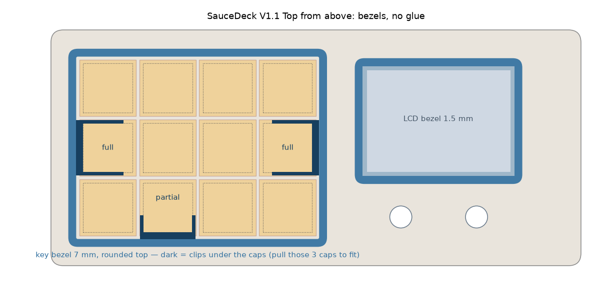

# Enclosure

3D-printable parts for SAUCEDECK. They are a remix of the SauceDeck v1.1 enclosure and are
meant to be printed **together with the original Top** from MakerWorld (not included here,
download it from the original model page).

## Attribution

These files are a remix of **"SauceDeck v1.1"** by **HotTabascoSauce**, published on MakerWorld:
<https://makerworld.com/en/models/3232541-saucedeck-v1-1#profileId-3678032>,
licensed under [CC BY-NC-SA 4.0](https://creativecommons.org/licenses/by-nc-sa/4.0/).

Modified by Antoine Voiry, October 2026.

## Files

| File | What it is | Print |
| --- | --- | --- |
| `stl/SauceDeck-V1.1-base-pockets.stl` (+ `.step`) | Modified Base | Flat, 173.1 × 68.8 × 9 mm |
| `stl/SauceDeck-V1.1-key-bezel.stl` | New ring around the 4 × 3 keys | Flat, ~6.4 g |
| `stl/SauceDeck-V1.1-lcd-bezel.stl` | New frame around the LCD window | As exported (upside down), ~1.4 g |

## Changes from the original

**Base** (`SauceDeck-V1.1-base-pockets`), made from the original STEP:

- Removed the ESP32-S3 DevKitC seat. Added a pocket for a **40 × 32 mm perfboard carrying an
  ESP32-S3 SuperMini**: 46 × 48 mm, 3.4 mm deep, against the USB end wall, with a 2 mm rim on the
  other three sides. The extra room (6 mm along, 16 mm across) lets you line the USB-C up with
  the existing slot in the Top.
- Added one shared pocket (68 × 42 mm) behind it for the **Waveshare MCP23017 board** (38 × 23 mm)
  and the **WS2812B LED board** (40 × 40 mm).
- Plate made **3 mm thicker underneath** to make room for the pockets. Screw holes extended,
  head seats unchanged, so the same screws fit. The deck stands 3 mm taller.
- Only the Base changes: the original Top is reused as is.

**Key bezel** (new part):

- Ring around the 4 × 3 key block: opening 77 × 58 mm (1 mm around 18 mm keycaps),
  2.5 mm wall, 7 mm tall, R1.2 rounded top edge, R3 outer corners.
- Glue-free: three small locks hidden under the keycaps grip the switch housings (two closed
  collars around the middle-left and middle-right switches, one spring fork on the front row).
  To fit it, pull those three caps, push the bezel down, refit the caps.
- Switch housing size (15.6 mm) is a nominal value: measure your switches if the fit is off.

**LCD bezel** (new part):

- 1.5 mm tall frame around the original LCD window, 2.5 mm wall, visible opening 45.5 × 32.4 mm
  (larger than the 40.8 × 30.6 mm active area of a 2.0" ST7789).
- Glue-free: a skirt with 10 crush ribs goes 2.5 mm into the window and stops 0.5 mm above the
  LCD glass. Knobs up to Ø21 mm clear its bottom edge.

## License

The files in this directory are licensed under the
[Creative Commons Attribution-NonCommercial-ShareAlike 4.0 International License](https://creativecommons.org/licenses/by-nc-sa/4.0/)
(CC BY-NC-SA 4.0), the same license as the original model:

- **Attribution**: credit HotTabascoSauce (original) and this repository (remix), and link the license.
- **NonCommercial**: no selling of the files or of printed/assembled decks.
- **ShareAlike**: remixes must be released under CC BY-NC-SA 4.0.

The MIT license at the repository root does not apply to this directory.
